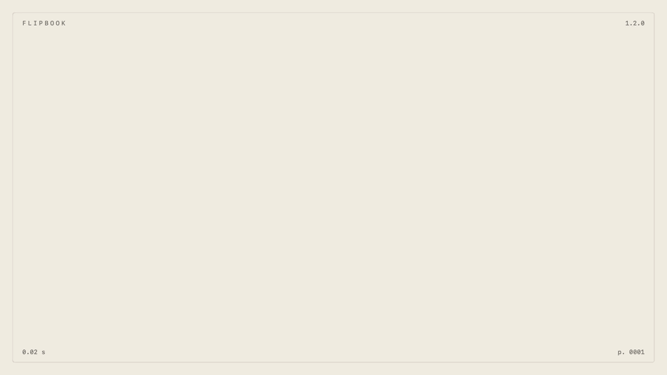
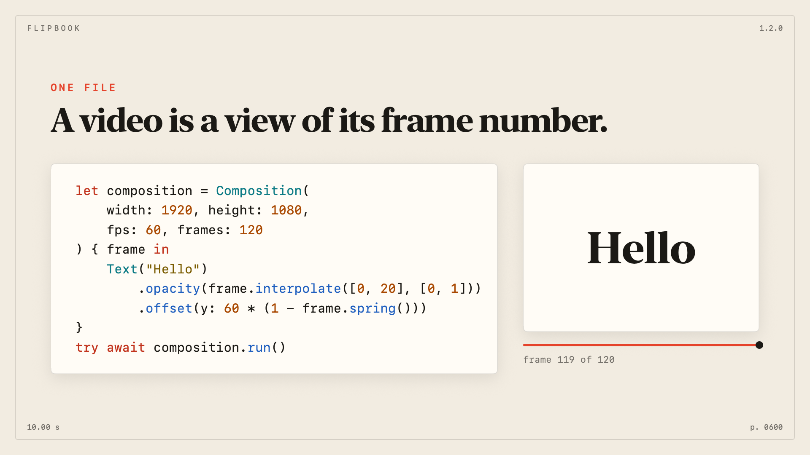
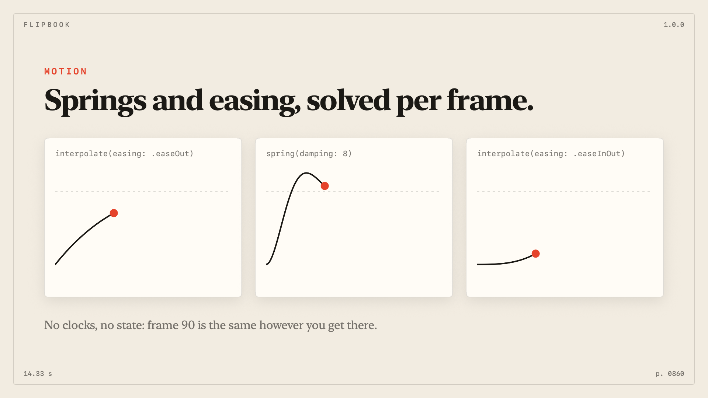
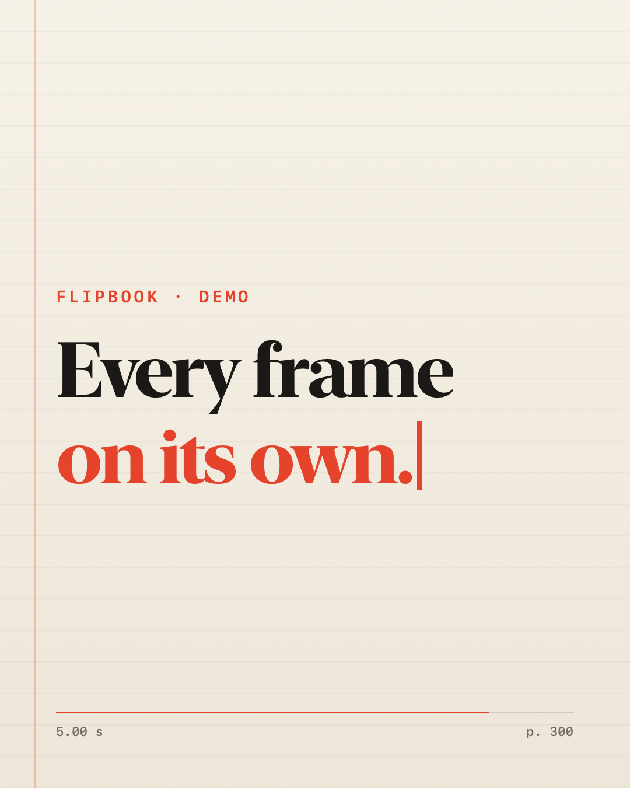
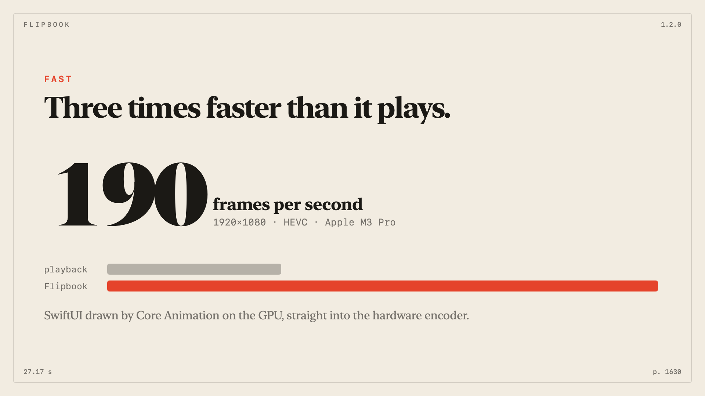
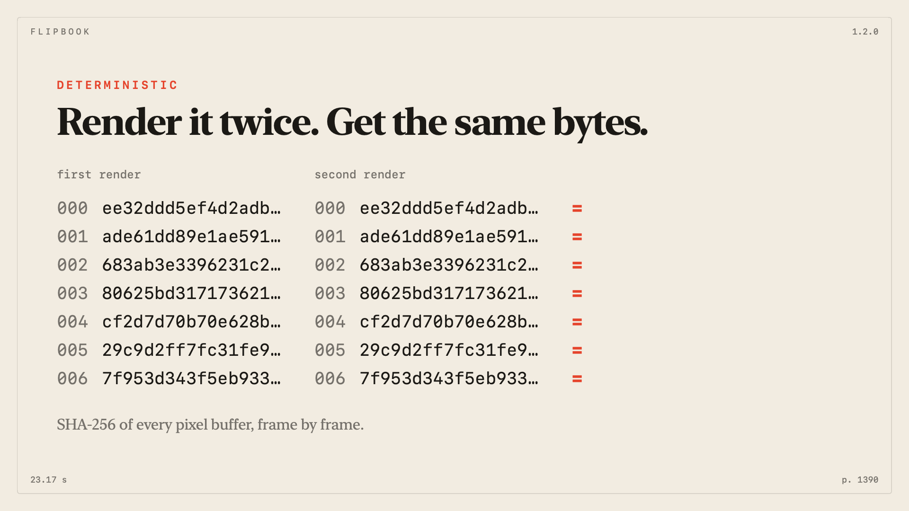

# Flipbook

[](https://github.com/IKatsuba/flipbook/releases/download/1.0.0/flipbook-promo.mp4)

Videos from SwiftUI views, where every frame is a pure function of its number. A Swift package for macOS on Apple Silicon, with no dependencies. The clip above was made with it; click it for the [video](https://github.com/IKatsuba/flipbook/releases/download/1.0.0/flipbook-promo.mp4) (there is a [4K one](https://github.com/IKatsuba/flipbook/releases/download/1.0.0/flipbook-promo-4k.mp4) too), and its source is [Examples/promo](Examples/promo).

It began as an experiment, prompted by [MyGo's Render plugin](https://mygo.run/docs/plugins/render): how fast can SwiftUI be turned into video, measured honestly? The measurements are below.

```swift
import Flipbook
import SwiftUI

let comp = Composition(width: 1080, height: 1350, fps: 60, frames: 120) { frame in
    Text("Hello")
        .opacity(frame.interpolate([0, 20], [0, 1]))
        .offset(y: 60 * (1 - frame.spring()))
}
try await comp.video(to: URL(filePath: "out/hello.mp4"))
```

```swift
.package(url: "https://github.com/IKatsuba/flipbook", from: "1.0.0")
```

Add the `Flipbook` product to an executable target, put the code above in its `main.swift`, and `swift run`. It needs macOS 15.

## The command

`flipbook` renders a scene written as one Swift file, with no package around it:

```sh
git clone https://github.com/IKatsuba/flipbook && cd flipbook
swift build -c release
ln -s "$PWD/.build/release/flipbook" /usr/local/bin/flipbook

flipbook doctor                        # what this machine is missing, and what to install
flipbook new hello.swift               # a scene to start from
flipbook still hello.swift --frame 90  # out/hello-90.png
flipbook render hello.swift --out videos/hello.mp4
flipbook preview hello.swift           # a window that plays it, with a scrubber
```

A scene file is the code at the top of this page with `try await composition.run()` as its last line. The command copies it into a package in `~/Library/Caches/flipbook`, builds it there (the library once, about a minute; a changed scene in a few seconds) and runs it where you are, so `--out` is your path and nothing is written beside the scene. A scene that does not compile comes back with the compiler's errors against your file and line, and exit status 2.

It is meant to be handed to a coding agent. `flipbook skill` prints the guide an agent needs: the scene format, the API with its defaults, the rules that keep frames deterministic, and what to do per error. `flipbook doctor --json` says what is missing and how to get it, and every command takes `--json`. Given only the path of the command and "make a six second video announcing X in this folder", an agent that had never seen it produced the video on its first compile; what it had to guess went back into the guide.

A symlink keeps the command using the checkout it was built in. A copy of the binary on its own fetches the library from this repository at the command's version instead, which needs that version to be released.

## What it does



A `Composition` is a size in points, a frame rate, a length in frames, a `scale` (pixels per point) and a view of a `Frame`. The video is `width × scale` by `height × scale` pixels.

```swift
try await comp.video(to: url)                                    // HEVC in .mp4
try await comp.video(to: url, codec: .h264)
try await comp.video(to: movie, codec: .proRes4444)              // .mov, with alpha when comp.transparent is set
try await comp.video(to: url, range: 60..<150) { done, total in print("\(done)/\(total)") }
try await comp.video(to: url, audio: URL(filePath: "music.m4a")) // a sound file under it, cut to its length
try await comp.video(to: url, prioritizeSpeed: true)             // about 60% faster, see below
let image = try comp.still(at: 42)                               // a CGImage
try comp.still(at: 42, to: URL(filePath: "out/frame.png"))
comp.preview()                                                   // a window that plays it, with a scrubber
```



`Frame` is the only thing a view may depend on. It has `index`, `time` and `progress`, and:

- `interpolate` from frame numbers to numbers or colours, piecewise, with easing;
- `spring`, a damped spring solved in closed form (and checked in the tests against fixed-step integration), with `settle:` to make it arrive exactly after a number of frames;
- `sequence(from:duration:)`, `shift(by:)` and `loop(duration:)` to cut the timeline into scenes;
- `typed` for text that is typed in, `fade(in:out:)` for a scene's opacity, and `snap` to round an animated offset to whole pixels.

The rule: no `withAnimation`, no `.animation`, no `Date()`, no `TimelineView`, and load fonts and images before rendering (`Fonts.register(at:)` takes a font file or a folder of them and returns the names for `Font.custom`). Flipbook disables animations in the transaction of every frame, but cannot stop a view from reading a clock.

## The demo



`flipbook-demo` is the scene everything below was measured on: 1080×1350 points, 360 frames at 60 fps, a paper gradient, ruled lines drawn in a `Canvas`, a line of text on a spring and a line that is typed, a page number and a progress bar that change every frame.

```sh
swift run -c release flipbook-demo                                  # out/demo.mp4, 2160×2700, 6 s
swift run -c release flipbook-demo render --path image-renderer --speed 1
swift run -c release flipbook-demo still --frame 90 --out out/frame.png
swift run -c release flipbook-demo preview                          # a window that plays the scene, with a scrubber
swift run -c release flipbook-demo verify                           # determinism, see below
swift run -c release flipbook-demo layers                           # the CALayer tree SwiftUI builds
swift run -c release flipbook-demo bench-all                        # the tables below, several minutes
swift run -c release --package-path Examples/promo promo            # out/flipbook-promo.mp4
```

## Render paths

All four fill a BGRA, IOSurface-backed `CVPixelBuffer` from the `AVAssetWriterInputPixelBufferAdaptor`'s pool and hand it to `AVAssetWriter` with a hardware encoder required.

| Path | How | Works |
| --- | --- | --- |
| `core-animation` (default) | `NSHostingView` in a window that is never ordered in; `CARenderer` draws its layer tree into a Metal texture that is the pixel buffer's IOSurface | Yes |
| `image-renderer` | `ImageRenderer.cgImage`, then `CGContext.draw` into the pixel buffer | Yes, but see Determinism |
| `image-renderer-direct` | `ImageRenderer.render(rasterizationScale:)` into a `CGContext` wrapping the pixel buffer | Yes, slowest |
| `metal-composite` | A Metal fragment shader draws the backdrop (paper, rules, margin) into that texture, then `CARenderer` draws the SwiftUI text over it | Yes; needs `Composition.backdrop` |

### What turned out differently from what was expected

**`ImageRenderer.cgImage` is not CPU rasterisation.** On macOS 26 the `CGImage` it returns is lazy and backed by a RenderBox image provider: a `sample` of the process shows the Metal driver loaded and the main thread inside `CGContextDrawImage → RB::ImageProvider::copy_image_block_set → wait_phase`, followed by a vImage pixel format conversion and a `memmove`. So it already rasterises on the GPU and pays for a readback and a copy. The variant that really is CPU rasterisation is `image-renderer-direct` (`argb32_shade_radial_RGB`, `blt_bitmap_blend_AXXX32` and friends at the top of the profile), and it draws roughly four times slower.

**SwiftUI can be GPU-composited without an on-screen window, with two caveats.** `flipbook-demo layers` shows what SwiftUI hands to Core Animation for the demo: solid colours as plain backing layers, the gradient as a `GradientLayer`, the `Canvas` as a `RenderBoxLayer` with an `RBImageQueueLayer` (drawn by RenderBox on the GPU), and every `Text` as a `CGDrawingLayer` whose contents are a CPU-rasterised bitmap. `CARenderer` composites all of them correctly, and in step: frame N of this path is closer to frame N of `image-renderer` than to either neighbour for every frame checked (`flipbook-demo cross`).

- A hosting view with no window at all does build a layer tree, but it is wrong: sublayers are positioned bottom-up while their contents stay upright (the headline ends up above the kicker, each right way up), layer `contentsScale` stays 1 so text is soft at 2x, and neither `isGeometryFlipped` on a parent layer nor wrapping the view in a plain `NSView` fixes it (the first mirrors the glyphs, the second renders black). Putting the hosting view in a borderless `NSWindow` that is never ordered in fixes the geometry; the window subclass overrides `backingScaleFactor` to get the composition's scale regardless of the attached display. The result then only needs one vertical flip.
- `CARenderer` does not clear what its layers leave transparent. Rendering into a fresh private texture gave magenta with trails of earlier frames. The `metal-composite` path uses that: the shader fills the target first and Core Animation composites the text onto it, with no intermediate texture. A transparent composition clears the target itself before every frame.

Both caveats rest on undocumented behaviour (the `backingScaleFactor` override, `CARenderer` on a window's own layer tree), verified only on the OS below.

## Benchmarks



Apple M3 Pro (12 cores), 18 GB, macOS 26.6.2 (25G83), Swift 6.4, release build. The demo: 360 frames at 60 fps. Every row is three runs, each in a fresh process that first renders 30 frames to warm up; times come from `ContinuousClock`. fps is frames divided by wall time from the first frame to the closed file. CPU is user plus system time of the process (all threads) per frame, from `getrusage`. Draw is the wall time to build the SwiftUI view and have its pixels in the buffer; encoder wait is time spent in `append` waiting for the encoder to accept more. Peak RSS is `ru_maxrss`; it does not count IOSurface memory, which is where the pixel buffers live, so peak physical footprint is listed as well. "Speed first" sets `kVTCompressionPropertyKey_PrioritizeEncodingSpeedOverQuality` (`prioritizeSpeed: true`); the bitrate target is the same, and frame 200 measured 42.9 dB PSNR against the unencoded frame by default and 42.7 dB speed first.

| Path | Encoder | Pixels | fps, median (min–max) | CPU ms/frame | Draw ms/frame | Encoder wait ms/frame | Peak RSS, MB | Peak footprint, MB | Output, MB |
| --- | --- | --- | --- | --- | --- | --- | --- | --- | --- |
| `image-renderer` | hevc | 1080×1350 (1x) | 258.8 (257.8–261.8) | 2.41 | 2.60 | 1.07 | 286.1 | 224.4 | 3.8 |
| `image-renderer-direct` | hevc | 1080×1350 (1x) | 177.4 (173.4–180.6) | 5.85 | 5.56 | 0.03 | 66.3 | 43.6 | 2.7 |
| `core-animation` | hevc | 1080×1350 (1x) | 258.8 (257.4–259.1) | 1.67 | 1.96 | 1.69 | 65.0 | 266.2 | 3.6 |
| `metal-composite` | hevc | 1080×1350 (1x) | 270.3 (270.0–273.7) | 1.50 | 1.29 | 2.22 | 62.2 | 227.0 | 0.5 |
| `image-renderer` | hevc, speed first | 1080×1350 (1x) | 400.2 (399.9–400.7) | 2.11 | 2.36 | 0.03 | 281.0 | 219.0 | 4.1 |
| `image-renderer-direct` | hevc, speed first | 1080×1350 (1x) | 174.4 (153.1–174.6) | 5.98 | 5.67 | 0.03 | 65.2 | 42.4 | 3.0 |
| `core-animation` | hevc, speed first | 1080×1350 (1x) | 397.6 (397.4–400.2) | 1.23 | 1.80 | 0.58 | 65.5 | 266.7 | 3.9 |
| `metal-composite` | hevc, speed first | 1080×1350 (1x) | 396.1 (395.8–396.7) | 1.10 | 1.06 | 1.34 | 62.2 | 224.9 | 0.6 |
| `core-animation` | h264 | 1080×1350 (1x) | 271.8 (271.0–272.5) | 1.67 | 2.00 | 1.48 | 65.2 | 267.8 | 2.1 |
| `image-renderer` | hevc | 2160×2700 (2x) | 71.5 (71.5–71.6) | 8.10 | 9.18 | 4.06 | 987.4 | 503.6 | 13.0 |
| `image-renderer-direct` | hevc | 2160×2700 (2x) | 50.4 (43.3–50.7) | 20.10 | 19.66 | 0.04 | 122.0 | 131.0 | 11.9 |
| `core-animation` | hevc | 2160×2700 (2x) | 72.2 (63.8–72.4) | 2.44 | 4.10 | 9.30 | 67.3 | 571.2 | 9.9 |
| `metal-composite` | hevc | 2160×2700 (2x) | 77.5 (77.4–77.5) | 4.40 | 4.79 | 7.46 | 63.9 | 508.2 | 0.8 |
| `image-renderer` | hevc, speed first | 2160×2700 (2x) | 117.1 (116.8–117.1) | 5.57 | 7.11 | 0.98 | 988.7 | 504.5 | 11.6 |
| `image-renderer-direct` | hevc, speed first | 2160×2700 (2x) | 49.3 (49.2–49.7) | 20.60 | 20.14 | 0.04 | 121.8 | 130.7 | 12.4 |
| `core-animation` | hevc, speed first | 2160×2700 (2x) | 116.0 (115.7–116.2) | 2.86 | 4.75 | 3.40 | 68.2 | 572.6 | 11.3 |
| `metal-composite` | hevc, speed first | 2160×2700 (2x) | 116.1 (116.0–116.3) | 3.06 | 3.88 | 4.27 | 63.9 | 516.7 | 0.8 |
| `core-animation` | h264 | 2160×2700 (2x) | 76.1 (71.6–76.6) | 3.09 | 4.37 | 8.24 | 67.7 | 548.8 | 7.3 |
| `core-animation` | hevc | 1920×1080 (1x) | 182.7 (120.4–187.5) | 3.19 | 3.36 | 1.86 | 65.7 | 321.5 | 4.4 |
| `metal-composite` | hevc | 1920×1080 (1x) | 204.2 (201.6–204.6) | 3.11 | 2.48 | 2.18 | 62.4 | 278.2 | 0.4 |
| `core-animation` | hevc, speed first | 1920×1080 (1x) | 302.6 (298.2–304.3) | 2.17 | 2.16 | 0.97 | 66.4 | 316.5 | 4.6 |
| `metal-composite` | hevc, speed first | 1920×1080 (1x) | 309.6 (308.8–310.0) | 1.01 | 1.02 | 2.04 | 62.3 | 264.1 | 0.5 |

The last four rows are 1920×1080, the frame size MyGo's 242 fps is quoted for. The scene, the machine and the encoder settings behind that number are not the same as here, so this is the same order of magnitude and no more: 183 to 204 fps with default HEVC, 303 to 310 fps speed first.

Where the time goes, with the encoder taken out and then left alone ("drawing only" reuses one pixel buffer; "encoder only" renders 30 consecutive frames beforehand and times encoding 360 frames that cycle through them):

| What runs | Pixels | fps, median (min–max) | CPU ms/frame | Peak RSS, MB | Peak footprint, MB |
| --- | --- | --- | --- | --- | --- |
| `image-renderer`, drawing only | 1080×1350 (1x) | 641.5 (592.1–650.4) | 1.26 | 267.6 | 215.3 |
| `image-renderer-direct`, drawing only | 1080×1350 (1x) | 177.9 (171.8–178.8) | 5.62 | 62.1 | 37.5 |
| `core-animation`, drawing only | 1080×1350 (1x) | 1072.1 (970.3–1120.8) | 0.45 | 65.7 | 245.4 |
| `metal-composite`, drawing only | 1080×1350 (1x) | 1524.0 (1514.0–1598.4) | 0.47 | 63.3 | 218.3 |
| encoder only, hevc | 1080×1350 (1x) | 259.4 (259.3–261.5) | 1.59 | 64.7 | 372.7 |
| encoder only, hevc, speed first | 1080×1350 (1x) | 411.1 (408.7–411.5) | 0.53 | 65.5 | 371.5 |
| encoder only, h264 | 1080×1350 (1x) | 278.3 (277.6–279.3) | 0.51 | 65.0 | 371.0 |
| `image-renderer`, drawing only | 2160×2700 (2x) | 200.9 (196.7–202.1) | 4.09 | 919.1 | 471.6 |
| `image-renderer-direct`, drawing only | 2160×2700 (2x) | 47.2 (47.2–47.9) | 21.17 | 111.9 | 112.6 |
| `core-animation`, drawing only | 2160×2700 (2x) | 611.5 (585.7–614.8) | 0.55 | 67.7 | 529.5 |
| `metal-composite`, drawing only | 2160×2700 (2x) | 1393.5 (1278.4–1404.8) | 0.50 | 65.0 | 511.6 |
| encoder only, hevc | 2160×2700 (2x) | 71.8 (71.5–72.1) | 2.74 | 66.8 | 1008.7 |
| encoder only, hevc, speed first | 2160×2700 (2x) | 116.5 (116.0–116.5) | 2.41 | 67.2 | 1008.8 |
| encoder only, h264 | 2160×2700 (2x) | 76.3 (76.2–76.4) | 2.11 | 67.1 | 1008.1 |

**The bottleneck is the hardware encoder, not SwiftUI.** With default settings every GPU path lands on the encoder-only number (72 fps at 2x, about 260 fps at 1x) whatever its draw cost, and the time saved drawing reappears as encoder wait. HEVC and H.264 are within about 6% of each other. Speed first raises the ceiling by about 60%, and the paths again sit on it (116 to 117 fps at 2x).

The encoder's speed barely depends on what is in the picture. Two earlier versions of this scene, a dark one with film grain that changed every frame and the same without the grain, had encoder-only ceilings of 75 and 72 fps at 2x; this one has 72. Two probes made with the grainy scene, not repeated since: feeding the encoder NV12 instead of BGRA changed nothing (75.5 against 75.8 fps at 2x, so colour conversion is not the cost), and neither did moving the bitrate between 8 and 80 Mbit/s (75 to 77 fps).

Behind the encoder, drawing costs: SwiftUI through Core Animation manages about 610 fps at 2160×2700 (0.55 ms of CPU a frame), and moving the paper, rules and margin out of SwiftUI into one shader takes that to about 1400 fps. `image-renderer`'s readback and copy leave it at 200 fps and several hundred MB of RSS. `image-renderer-direct` is bound by CPU rasterisation at 21 ms a frame for 2x.

One thing the output sizes show and nothing here explains for certain: with the backdrop in the shader the file is ten times smaller (0.8 against 10 MB at 2x). The likeliest reason is that Core Animation dithers the gradient it draws and the shader does not, which leaves the encoder a noisy surface in one case and a smooth one in the other.

## Determinism



`flipbook-demo verify` hashes (SHA-256) the pixel buffer of every frame, renders the composition twice in one process with separate renderers, and renders it once more starting at frame 120. `flipbook-demo hashes`, run twice as separate processes, was compared with `cmp`.

| Path | Two processes | Twice in one process | Started mid-way |
| --- | --- | --- | --- |
| `core-animation` | identical | identical | identical |
| `image-renderer` | identical | **9 of 360 frames differ at 1x, 11 at 2x** | differs in a fresh process |
| `image-renderer-direct` | identical | identical | identical |
| `metal-composite` | identical | identical | identical |

All 360 frames are distinct in every path (the page number and the progress bar change every frame).

`image-renderer` is reproducible but not pure. Rendering the same sequence in a fresh process gives byte-identical buffers every time. Within one process, the second pass differs from the first on frames 1, 2, 11, 12, 13, 29, 30, 38 and 39 at 1x, by at most 2 in one 8-bit channel (`flipbook-demo diff`: between 52 and 160 000 pixels). Those are the first frames after something is drawn for the first time in the process: the first visible frames, the frames where the page's opacity reaches 1, the first frames with each line of text. With an earlier scene, a render started at frame 5 or 13 in a fresh process differed from the full render on its own first two frames in the same way. So with `ImageRenderer.cgImage` a frame depends, in the last bit, on what the process drew before it; the cause is inside RenderBox and was not pinned down further. Second and third passes agree with each other.

The other three paths passed every check, so on this machine their frames are a function of the frame number alone. Nothing here says anything about other GPUs or OS versions: the GPU paths are not expected to match each other or another machine bit for bit, and they differ from `image-renderer` by a fraction of a level.

## Text that hops by a pixel

At 1x, text that is moved by a spring keeps hopping by a pixel long after it looks still. A spring's tail never reaches 1, SwiftUI puts every text layer on whole pixels, and a resting position that falls on half a pixel rounds one way with a tiny offset and the other way without it. Measured on a 1920×1080 scene, a caption went 970, 971, 970 over two seconds. Two things fix it: `spring(settle:)`, which bends the curve to land exactly, and `frame.snap`, which rounds an animated offset to whole pixels. At 2x the hop is half a point and hard to see.

A related one: a `.shadow` on a container gives every text layer inside it a shadow of its own in the `core-animation` path. Put the shadow on the background shape instead.

## What to try next

- More than one encoder. A single hardware session is the ceiling; splitting the timeline into segments encoded by parallel `VTCompressionSession`s and concatenated would show whether the media engine scales.
- Rendering and encoding overlapped properly. The loop waits for the GPU after every frame; with the encoder as the limit that is free today, but it will matter once the encoder is faster.
- Find what makes `ImageRenderer.cgImage` differ on first draws. It is why `core-animation` is the default: as fast, far less resident memory, and pure, at the price of leaning on undocumented behaviour.
- Text is still rasterised on the CPU into `CGDrawingLayer` bitmaps. It is cheap here; a scene with far more changing text would show whether that becomes the draw bottleneck.
- Scenes that are harder for Core Animation: blurs, masks, `drawingGroup()`, images, and whether each survives `CARenderer` offscreen.
- Motion blur by averaging sub-frame samples; HEVC with alpha; sound placed per sequence rather than one file under the whole video.

## Licence

[MIT](LICENSE).
